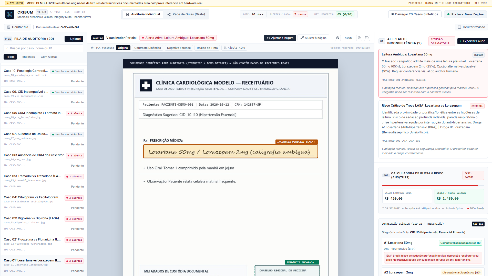
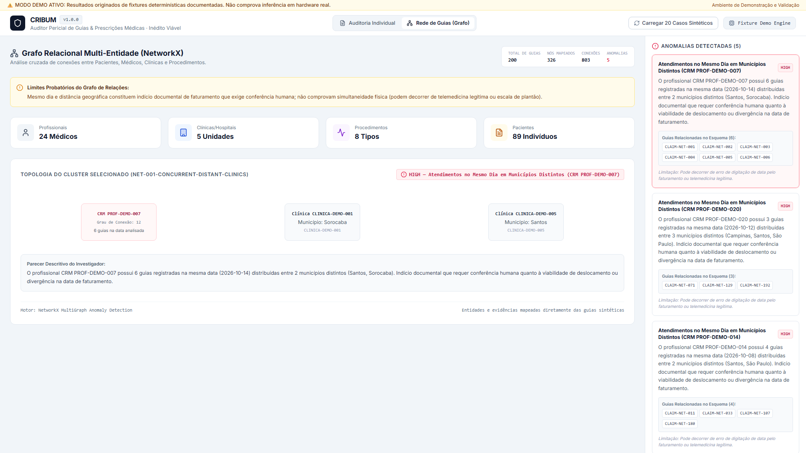

<div align="center">

# CRIBUM 🛡️


### *IA Multiagente para Segurança de Medicação (LASA), Tecnologia Assistiva & Auditoria em Saúde*
> **O crivo inteligente para prevenção de erros médicos em receitas, segurança farmacológica LASA e auditoria de conformidade no SUS e na Saúde Suplementar (ANS).**  
> *Arquitetura multiagente Privacy-First (LGPD) com Visão Computacional Multimodal (**Qwen2-VL**), Grafos Relacionais (**NetworkX**) e Cadeia de Custódia **Merkle Tree (RFC 6962)**.*

[](https://github.com/TheyDreez/cribum)
[](https://github.com/TheyDreez/cribum)
[](https://datatracker.ietf.org/doc/html/rfc6962)
[](https://github.com/TheyDreez/cribum)
[](docs/AMD_SETUP.md)
[](LICENSE)

</div>

---

## 🎬 Demonstração Oficial em Vídeo (Português - PT-BR)

> **Submissão — Campus Mobile, do Instituto Claro (Categoria: Saúde e Tecnologias Assistivas)**  
> Assista à demonstração completa de 1 minuto mostrando o fluxo em tempo real dos **4 agentes autônomos de IA**, desde a leitura de receituários com caligrafia ambígua até o bloqueio de trocas fatais de medicamentos **LASA** (*Losartana* vs. *Lorazepam*), emissão de laudo criptográfico **Merkle Tree (RFC 6962)** e detecção de anomalias em grafos:

👉 **[▶️ Assistir / Baixar Vídeo Oficial de Demonstração (`docs/Cribum_Campus_Mobile_Demo.mp4`)](https://github.com/TheyDreez/cribum/raw/main/docs/Cribum_Campus_Mobile_Demo.mp4)**

---

## 🎯 Propósito e Impacto em Duas Pontas: Do Bolso do Cidadão à Gestão de Saúde

Erros de medicação por grafia ou som semelhantes (**LASA** — *Look-Alike, Sound-Alike*) causam milhares de internações e óbitos evitáveis no Brasil, enquanto fraudes e glosas drenam **R$ 34 bilhões anualmente** do SUS e da saúde suplementar (conforme estimativas do Instituto de Estudos de Saúde Suplementar — IESS). O **CRIBUM** conecta duas pontas complementares através do mesmo motor multiagente:

### 1. 📱 Tecnologia Assistiva Mobile na Ponta (B2C / Impacto Social Direto)
* **Para quem:** Pacientes (especialmente **idosos, polimedicados e pessoas com baixa visão**), cuidadores familiares, enfermeiros e farmacêuticos na triagem de balcão.
* **Como atua:** Pelo celular, o usuário fotografa a receita médica e valida a prescrição em segundos. O sistema identifica caligrafias médicas ambíguas, alerta sobre riscos fatais de confusão entre medicamentos LASA catalogados pela **ANVISA / ISMP Brasil** (evitando, por exemplo, que um paciente hipertenso tome um ansiolítico/psicotrópico por engano) e aponta incompatibilidades com o diagnóstico (**CID-10**), democratizando a segurança clínica no bolso do cidadão.

### 2. 🏥 Auditoria Pericial e Integridade na Gestão (B2B / B2G — SUS e ANS)
* **Para quem:** Auditores médicos e de enfermagem do SUS, hospitais, clínicas, secretarias públicas de saúde e operadoras suplementares (ANS).
* **Como atua:** Processa filas de guias médicas (padrão **TUSS/ANS**), calcula automaticamente o risco clínico composto (**CCRI**) e a glosa preventiva evitada, cruza **multigrafos relacionais** para impedir fraudes e conluios (como faturamentos simultâneos em municípios distantes) e sela cada decisão humana em uma cadeia criptográfica imutável.

---

## 💎 Vitrine Visual da Plataforma

> *Interface responsiva em React 18 & TypeScript projetada tanto para inspeção clínica e assistiva quanto para auditoria pericial e visualização de redes complexas.*

```text
+---------------------------------------------------------------------------------+
| [CRIBUM WORKSTATION v1.0]   | Case: CASE-AMB-001 [AMBIGUOUS / LASA]  [CCRI: 94] |
+---------------------------------+-----------------------------------------------+
| [A4 Medical Image & BBox]       | [AI Findings & Clinical Correlation]          |
|  .---------------------------.  | - Alerta LASA: Losartana 50mg vs Lorazepam    |
|  | [X] Bounding Box 0..1     |  | - CID-10 I10 (Hipertensão) × Incompatibilidade|
|  |     (Visual Evidence)     |  | - Glosa Preventiva Calculada: R$ 1.480,00     |
|  '---------------------------'  | - Cadeia de Custódia SHA-256 (RFC 6962 Ativa) |
+---------------------------------+-----------------------------------------------+
| [Filtros Ópticos Forenses: Negatoscópio | Contraste Dinâmico | Realce de Tinta] |
+---------------------------------------------------------------------------------+
```

| Inspeção de Receituário, Hipóteses VLM & Segurança LASA (`CASE-AMB-001`) | Topologia Relacional & Detecção de Conluio em Grafo (`NetworkGraphView`) |
| :---: | :---: |
|  |  |

---

## 🤖 Arquitetura dos 4 Agentes Autônomos de IA (`backend/agents/`)

Diferente de sistemas baseados em OCR simples — que falham em caligrafias médicas, não compreendem contexto clínico e expõem dados sensíveis em nuvens públicas —, o **CRIBUM** opera com uma arquitetura coordenada de **4 agentes especializados** sob supervisão humana obrigatória (*Human-in-the-Loop*):

1. **👁️ Agente de Visão Multimodal (`backend/agents/leitor.py` — `Qwen2-VL`):**
   * Realiza leitura visual multi-hipótese (`top-3`) ciente de incerteza (`CERTAIN`, `AMBIGUOUS`, `INDETERMINATE`), ancorando cada campo extraído às coordenadas físicas exatas da imagem (*Bounding Boxes* normalizadas `0..1`).
2. **💊 Agente Farmacológico LASA (`backend/agents/farmaceutico.py`):**
   * Calcula distância fonética e ortográfica/visual sobre o banco de pares críticos de medicamentos **LASA (ANVISA / ISMP Brasil)**, cruza a indicação terapêutica com o diagnóstico **CID-10**, verifica integridade documental (CRM, unidade, posologia e duplicidade SHA-256) e computa o *Composite Clinical Risk Index* (**CCRI** de 0 a 100).
3. **🕸️ Agente de Grafos Relacionais (`backend/agents/investigador.py` & `backend/services/graph_engine.py`):**
   * Modela interações entre prescritores, clínicas, pacientes e procedimentos em multigrafos direcionados (**NetworkX**), identificando anomalias topológicas, faturamentos geograficamente incompatíveis no mesmo dia e redes de conluio.
4. **🔐 Agente Privacy-First & Custódia Merkle (`backend/agents/relator.py`):**
   * Garante conformidade com a **LGPD** e consolida o dossiê pericial (padrão TUSS/ANS) com selagem criptográfica encadeada em **Árvore de Merkle (RFC 6962)** (`prev_chain_hash` $\rightarrow$ `chain_hash`), assegurando rastreabilidade e imutabilidade jurídica.

*(Consulte [`docs/ARCHITECTURE.md`](docs/ARCHITECTURE.md) para o detalhamento técnico completo do pipeline e isolamento por execução).*

---

## 🧪 Validação em Fixtures Sintéticas e Testes Automatizados

O repositório inclui um conjunto de dados sintéticos gabaritados (100% livres de dados reais de pacientes) e suítes de testes automatizados:

### 1. Dataset Clínico Sintético (`backend/data/synthetic/`)
* **20 Casos Documentais Estruturados (`cases/` e `ground_truth/`):**
  * **Pares Críticos LASA (Casos 01 a 05):** *Losartana vs. Lorazepam*, *Fluoxetina vs. Flunarizina*, *Digoxina vs. Dipirona*, *Citalopram vs. Escitalopram* e *Tramadol vs. Trazodona*.
  * **Inconformidades Regulatórias e Clínicas (Casos 06 a 10):** Ausência de CRM do prescritor, ausência de unidade de medida, CRM incompleto, incompatibilidade entre medicamento e CID-10, e posologia contraditória (para inspeção visual e testes de robustez de schema).
  * **Fraudes por Duplicidade Documental (Casos 11 a 15):** Lotes de guias duplicadas submetidas em diferentes contextos para teste de colisão criptográfica e bloqueio de refaturamento.
  * **Grupo de Controle Regular (Casos 16 a 20):** Prescrições limpas e legíveis para validação de ausência de falsos positivos.
* **Rede Relacional de 200 Sinistros (`claims_200.json`):**
  * Grafo sintético com **200 guias médicas** conectando médicos, clínicas, pacientes e procedimentos para validação dos algoritmos de detecção de anomalias em rede.

### 2. Suíte de Testes Automatizados (37 Pytest Backend + 14 Playwright E2E)
O projeto conta com uma suíte de 51 testes automatizados (100% passando):
* **37 Testes de Backend (Pytest):** Executados a partir da raiz (`python -m pytest`), cobrindo contratos de API, motor farmacológico LASA, regras determinísticas, normalização Unicode NFKD, casos de borda, isolamento de persistência SQLite por `run_id`, integridade da cadeia criptográfica Merkle (RFC 6962) e protocolo do provedor VLM (`backend/tests/`).
* **14 Testes End-to-End de Interface (Playwright):** Validam a jornada visual no Chromium headless (`frontend/tests/e2e.spec.ts`), incluindo renderização de *bounding boxes* SVG, seleção de hipóteses, conferência humana (HITL) e inspeção do grafo de sinistros.

### 3. Transparência de Modo: Deterministic Fixture vs. VLM Real
Para permitir que avaliadores e recrutadores testem todo o pipeline forense imediatamente após o `git clone` — **sem exigir chaves pagas de API ou GPU dedicada local** —, o CRIBUM opera em dois modos:
* **Deterministic Fixture Engine (Padrão de Avaliação):** Reconhece os 20 casos estruturados do catálogo sintético (`CASE-AMB-001` a `CASE-CTR-020`) e fornece a extração base documentada para que os agentes e o motor de regras executem a auditoria de forma **100% reprodutível e determinística**.
* **Live VLM Mode:** Ativado mediante configuração de variáveis no `.env` (veja `.env.example`), conectando a inferência visual a instâncias locais aceleradas por GPU (`vLLM` com `Qwen2-VL`) ou provedores compatíveis.

> **Nota sobre Métricas (`eval/run_eval.py`):** O script de avaliação afere a **consistência lógica e determinística do motor de regras** contra o gabarito das fixtures sintéticas catalogadas, e não acurácia de OCR em receituários manuscritos de hospitais reais.

---

## ⚠️ Limitações Conhecidas e Escopo
Este projeto foi desenvolvido como protótipo de engenharia submetido ao **Campus Mobile, do Instituto Claro**. O sistema utiliza dados 100% sintéticos, base referencial de 10 pares críticos LASA (ISMP Brasil), validação estrutural de CRM e não é um dispositivo médico homologado (SaMD). Consulte os detalhes completos em [`docs/LIMITATIONS.md`](docs/LIMITATIONS.md).

---

## ⚡ Guia Rápido de Execução

> **Nota sobre Execução:** O **CRIBUM** roda imediatamente em **qualquer computador padrão (Windows, Linux ou macOS)** usando Python/FastAPI e React no modo de demonstração determinística (`DEMO`).  
> Os arquivos [`docker/docker-compose.rocm.yml`](docker/docker-compose.rocm.yml) e [`docs/AMD_SETUP.md`](docs/AMD_SETUP.md) compõem uma **camada adicional de infraestrutura hospitalar on-premise** para inferência multimodal 100% local acelerada por GPU (`vLLM` + `Qwen2-VL`), projetada para garantir soberania de dados e conformidade estrita com a **LGPD** sem envio de receitas médicas reais para APIs comerciais externas.

### Pré-requisitos
* **Python 3.12+**
* **Node.js 18+**

### 1. Iniciar o Backend (FastAPI + SQLite + Motor Multiagente)
```bash
git clone -b main https://github.com/TheyDreez/cribum.git
cd cribum
python -m venv .venv
source .venv/bin/activate  # No Windows (PowerShell): .\.venv\Scripts\activate
pip install -r backend/requirements.txt
uvicorn backend.api.app:app --port 8000 --reload
```

### 2. Iniciar o Frontend (React 18 + TypeScript + Tailwind CSS)
Em outro terminal:
```bash
cd cribum/frontend
npm install
npm run dev
```
Acesse **`http://localhost:5173`** no navegador e clique em **"Carregar 20 Casos Sintéticos"** no canto superior direito para inspecionar todos os cenários clínicos e o grafo relacional.

### 3. Executar as Suítes de Teste Automatizadas
* **Backend (37 testes em Pytest):**
```bash
python -m pytest
```
* **Frontend End-to-End (14 cenários em Playwright):**
```bash
cd frontend && npx playwright test
```
* **Avaliação de Consistência das Fixtures:**
```bash
python eval/run_eval.py
```

---

## ⚖️ Licença e Propriedade Intelectual
Código disponibilizado na modalidade **Source-Available para Avaliação Técnica e Acadêmica** (*Proprietary & Source-Available Evaluation License*). Todos os direitos patrimoniais e de propriedade intelectual pertencem a **André Rogério da Silva Filho**. Consulte o arquivo [`LICENSE`](LICENSE) para os termos completos.
